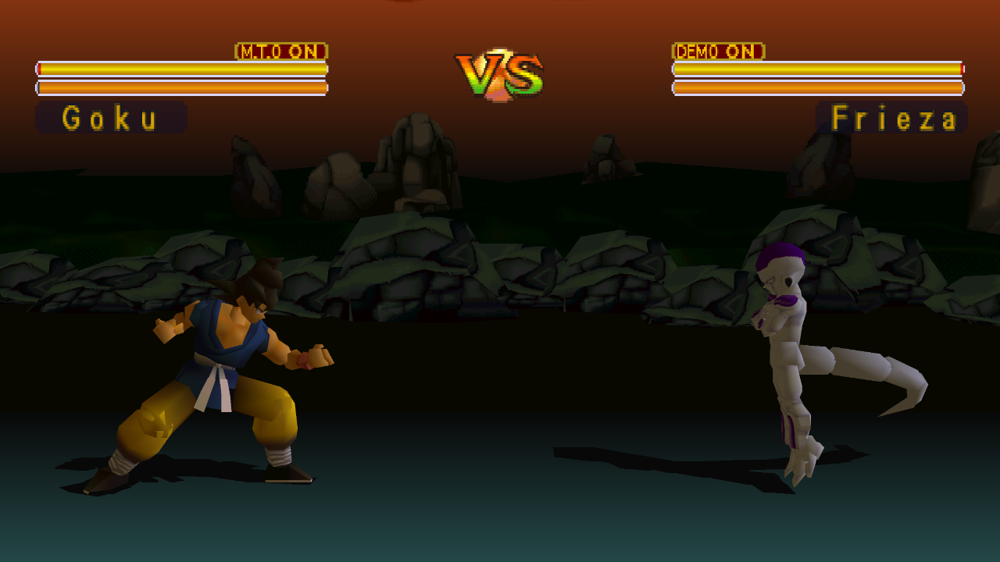

# Dragon Ball GT: Final Bout Recompiled

Play **Dragon Ball GT: Final Bout** on PC with higher internal resolution,
adaptive widescreen, online multiplayer, and an optional English voice mod
using recordings from **Dragon Ball Z: Budokai Tenkaichi 3**.

**[Download v1.0.0 for Windows x64](https://github.com/mstan/DragonBallGTFinalBoutRecomp/releases/tag/v1.0.0)**

## Features

- **Adaptive widescreen:** combat framing follows your window from 4:3 through
  21:9, with repositioned HUD elements and expanded stage backgrounds.
- **FuniDub:** English character voices drawn from your own USA Budokai
  Tenkaichi 3 ISO, covering introductions, combat grunts, attack calls and
  victory lines. Import once; subsequent launches reuse the local cache.
- **Netplay powered by recomp-net:** two-player online lobbies and LAN / direct
  IP play, plus local versus with separate controller ports.
- **Higher internal resolution**, controller configuration and save states,
  all accessible from the launcher.

## Getting started

1. Download the Windows x64 ZIP from the release page and extract it completely.
2. Run **DragonBallGTFinalBout_Recompiled.exe**.
3. Select your own **USA Final Bout disc image (SLUS-00493)** when prompted.
   Use a CUE + BIN image and keep its files together.
4. Choose your controller in the launcher and press **PLAY**.

The release includes OpenBIOS and the tools needed for local setup. You do not
need to install a compiler, Python or a retail PlayStation BIOS. The first run
may take longer while game overlays are compiled and cached.

No Final Bout disc data or Budokai Tenkaichi 3 recordings are included.

## Widescreen

Open **Mods → Display → Widescreen**, enable it, and set **Aspect ratio** to
**Adaptive**. Resize the window to change the combat view, or choose fixed
**16:9**. Original 4:3 framing is the default; menus and movies retain their
original presentation.

## FuniDub voices

Open **Mods → Audio → FuniDub**, enable it, and select your own **USA PS2
Budokai Tenkaichi 3 ISO (SLUS-21678)**. The launcher extracts and prepares the
replacement pack locally, with progress and cancellation available. Keep the
source selection saved so future launches can reuse the prepared pack.

FuniDub uses existing recordings, including suitable generic lines and grunts;
it is not a word-for-word translation, and mouth animation may not match every
line's length. Some cues keep their original voices. Music and movies remain
original. Disable the mod to return to the original audio.

FuniDub uses separate save-state slots; memory cards remain shared. See the
[FuniDub guide](docs/FUNIDUB.md) for coverage and cache details.

## Netplay

Choose **NETPLAY** in the launcher, then **Online Netplay** for lobbies or
**LAN / Direct IP** for a direct connection. The host creates a lobby, the other
player joins, and the host presses **PLAY** once both players are ready. Online
service access may ask you to sign in with Discord; direct IP needs no account.

Both players should use the same release and supported disc image. If you use
FuniDub, each player prepares it locally from their own donor ISO and uses the
same voice selection. The lobby checks compatible game and mod content; it
does not transfer game data or voice recordings.

## Help and development

This first release has had focused gameplay, widescreen, audio and two-player
checks. Some scenes, effects and progression routes remain untested; occasional
visual or stall issues may still occur. Report problems with your settings and
reproduction steps in [Issues](https://github.com/mstan/DragonBallGTFinalBoutRecomp/issues).

For source builds, see [Building](docs/BUILDING.md). Detailed
[validation notes](validation/README.md) and [widescreen notes](docs/WIDESCREEN.md)
are available for contributors.

Built with [PSXRecomp](https://github.com/RetroPortingToolKit/psxrecomp),
[recomp-ui](https://github.com/RetroPortingToolKit/recomp-ui), and recomp-net.
This is an unofficial fan project, unaffiliated with the original rights holders.
